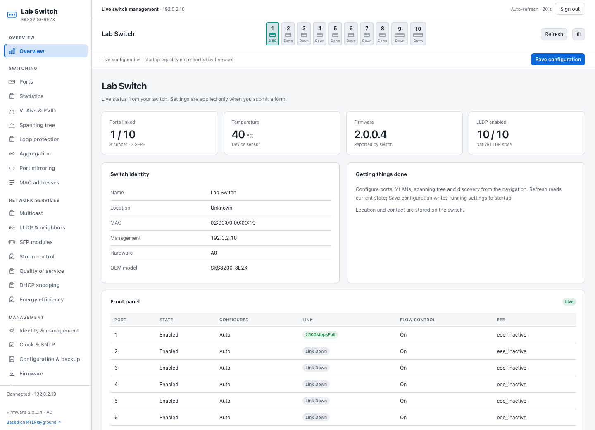
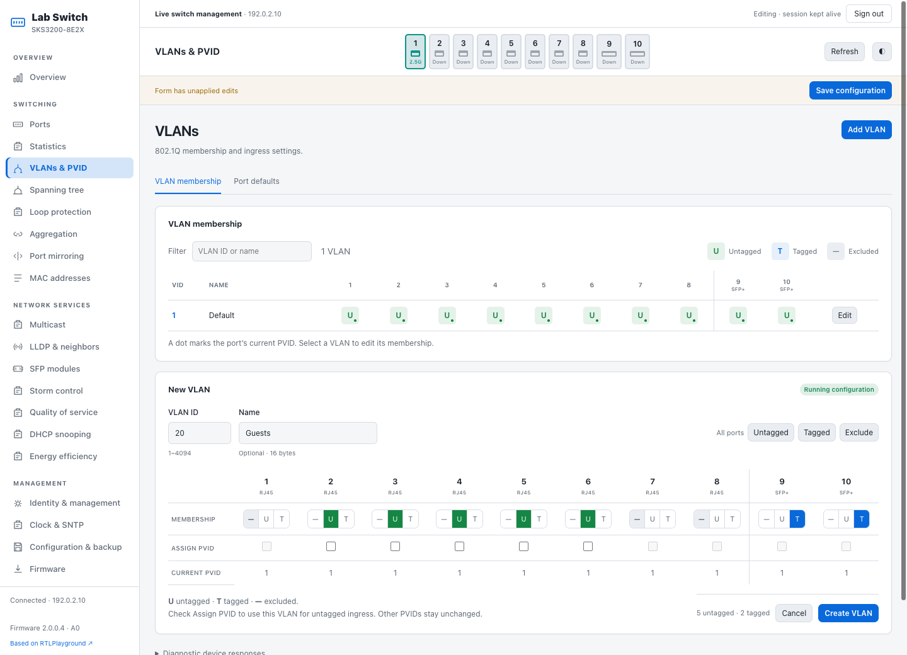
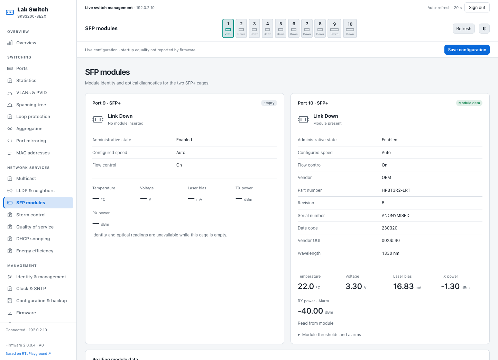
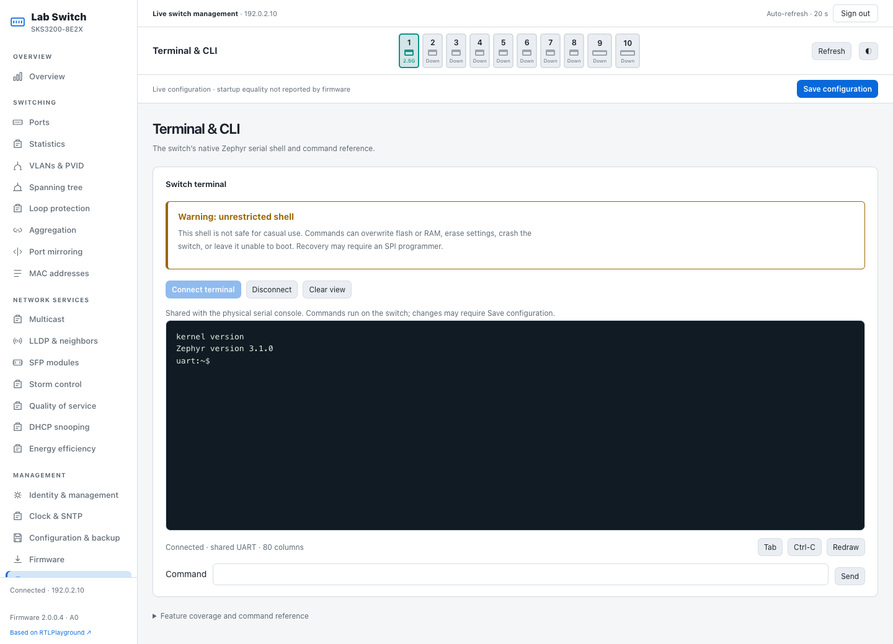
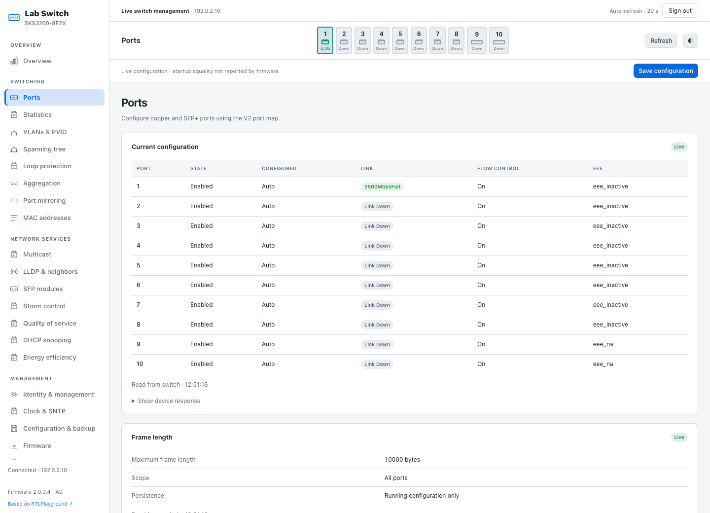
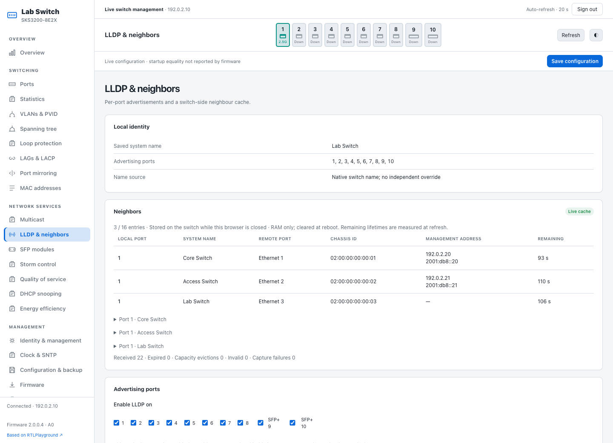
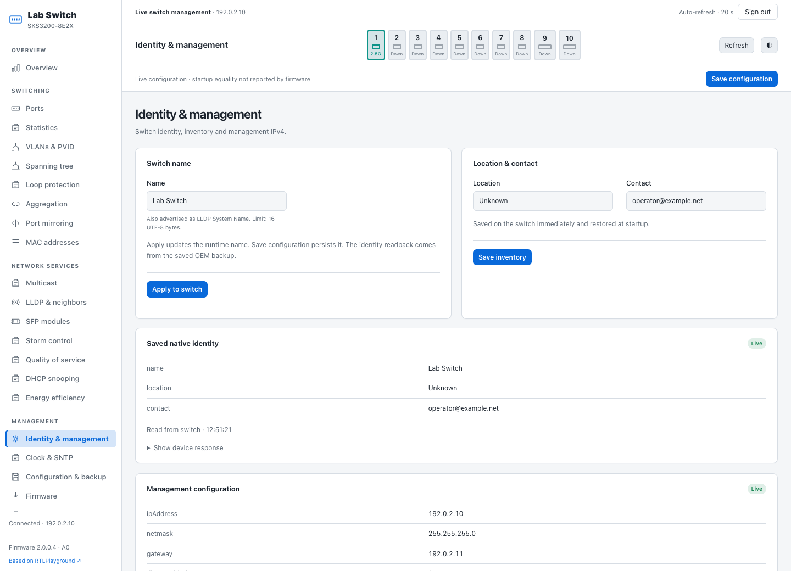
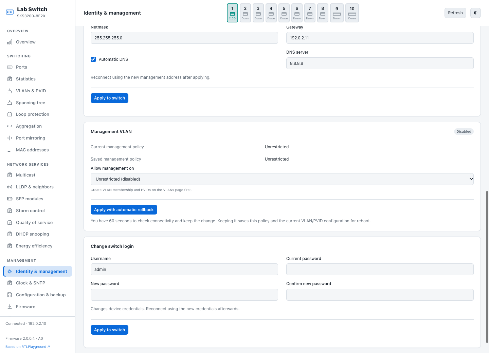
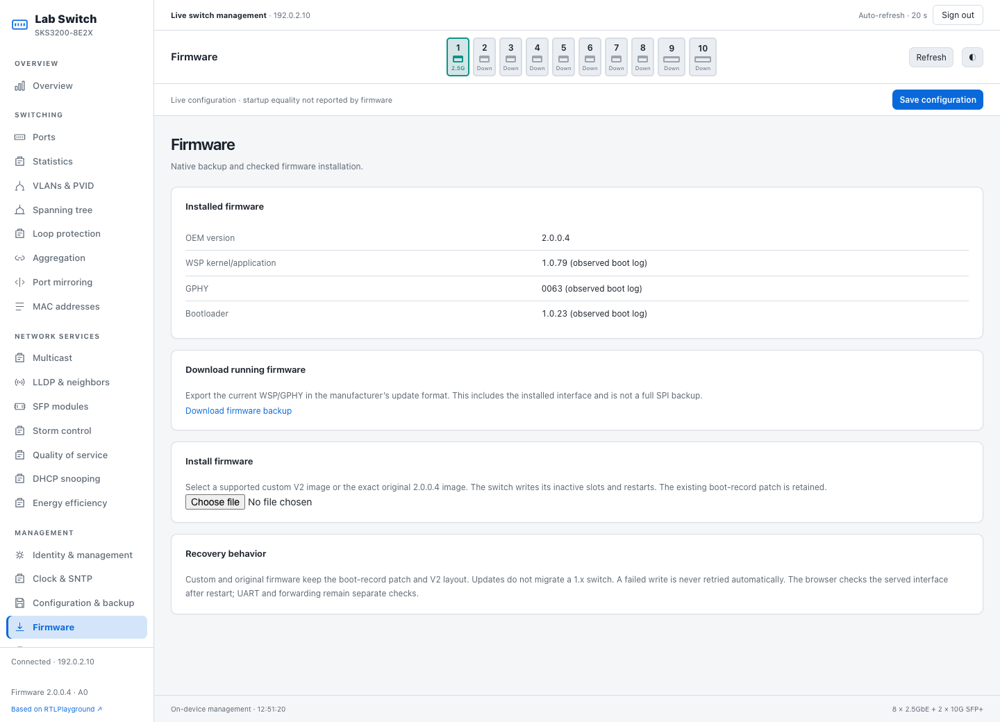
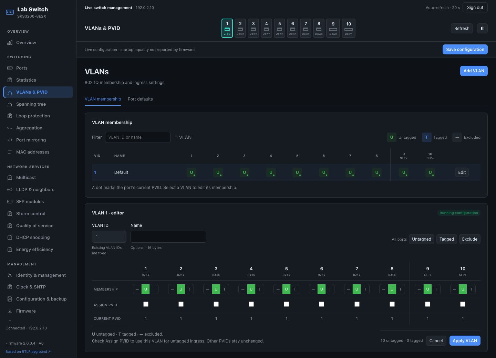

# MxL Playground

**Better VLANs. Visible optics. A real terminal.**

Your 2.5GbE switch has capable hardware. Its management interface should make
that easy to use. MxL Playground brings a modern, on-device web UI to the
GoodTop ZX310S-8T2XS: a clear VLAN editor, live SFP diagnostics, useful switch
identity and the actual Zephyr shell in your browser.

Inspired by [RTLPlayground](https://github.com/logicog/RTLPlayground), built for
our researched **MaxLinear MxL862xx / WSP** platform. The interface runs on the
switch's existing web server. Daily management needs only a browser.

[Build it](docs/BUILD.md) · [Install it](docs/SERIAL-INSTALLER.md) ·
[V1 → V2 migration](docs/MIGRATION.md) · [Recovery](docs/RECOVERY.md) ·
[Roadmap](docs/ROADMAP.md)

> **Experimental developer preview.** Tested on one GoodTop ZX310S-8T2XS,
> migrated from 1.0.0.6 to the exact supported 2.0.0.4 baseline. This is not a
> universal firmware image or a production-ready installation path.
>
> **Only flash if you have a compatible SPI programmer, or can obtain one
> quickly—for example overnight from Amazon where available.** The UART shell
> is part of WSP; a broken WSP can also remove serial recovery.

## Started with 1.x firmware? We upgraded ours to 2.x.

This project's GoodTop ZX310S-8T2XS originally ran **1.0.0.6**. We successfully
migrated that same switch to the factory **2.0.0.4** firmware, then built
MxL Playground on that V2 baseline.

**This requires changing the SPI flash partition table, not just uploading newer
firmware.** V2 needs larger WSP slots and moves the GPHY and persistent-data
partitions. The stock firmware's web updater cannot perform that layout migration;
uploading a V2 update to a stock V1 switch is not an upgrade path.

Our demonstrated migration uses an **external SPI programmer and clip** to read
the complete flash, build a device-specific image with the V2 partition table
and firmware, and reflash it. Unreliable in-circuit programming may require
isolating or removing the flash chip. A serial cable alone does not replace
this SPI migration procedure.

**[Read the V1 → V2 migration guide](docs/MIGRATION.md)** for the layout changes,
backup/build/programming steps and recovery requirements. The migration worked
on our switch. The offline builder now accepts other owners' backups with the
same audited V1.0.0.6 boot/firmware profile, while preserving their own board data
and settings. Unknown firmware, layouts and slot states are rejected; another
unit's hardware migration has not yet been tested. A switch already
on the supported V2 layout can proceed to the separate serial bootstrap and
web installation below.

## What makes it worth opening the case?

- **VLANs you can read at a glance.** Tagged, untagged and excluded membership
  in one matrix, with per-port controls and PVIDs alongside the editor.
- **Optics you can inspect.** SFP identity, temperature, voltage, laser bias,
  TX/RX power and alarms, including correct empty-cage handling.
- **A switch with an identity.** Give it a name, location and contact. The name
  is the homepage title and is also used for LLDP System Name.
- **The real shell, in your browser.** A shared Zephyr terminal with native
  commands, history and completion, behind an explicit flash/RAM warning.
- **Management that fits the job.** Management-VLAN controls with timed
  rollback, jumbo-frame controls, LLDP, STP, aggregation, mirroring, multicast,
  QoS, firmware export and checked web updates.
- **Local builds from your own firmware.** Supply the exact factory image;
  the patcher verifies it and builds your custom update locally. Vendor WSP,
  GPHY and bootloader binaries are not bundled with this project.

## Take a look

These are screenshots of the running on-switch interface, with device names,
addresses, contact details and module serial numbers anonymised. Click an image
for its full resolution. The VLAN draft below was **never applied**.

### VLANs without the guesswork

The membership matrix stays visible while you edit individual ports. This is an
unsaved example with access ports and tagged SFP+ ports; the live switch remains
on its existing configuration.

### See what your SFP is doing

An empty cage alongside a real BiDi module: identity and DOM readings are
available even with the optical link down. A missing reading stays missing.

### A real console, not a command-shaped settings page

This is the switch's native Zephyr shell, sharing the physical UART transport.
The capture shows the read-only `kernel version` command. It is a privileged
shell, not a sandbox; flash and RAM writes are possible.

### The rest of the workbench

| Ports and jumbo frames | LLDP and neighbors |
| --- | --- |
|  |  |

| Identity and management | Management VLAN |
| --- | --- |
|  |  |

| Firmware backup and updates | Dark mode |
| --- | --- |
|  |  |

## What is tested—and what is still experimental?

The interface and native extensions are running on the development switch.
Native web uploads, named identity, saved location/contact, LLDP startup, SFP
reads/hotplug and the shared browser/UART terminal have hardware evidence.
Management-VLAN confirmation, rollback and VLAN-1 warm startup pass. The guarded
installer has completed a live update on the already-bootstrapped unit.

The initial stock-to-custom transition, complete serial-only WSP upload/boot,
full SPI recovery, integrated tagged-client/cold-power isolation, linked optical
traffic, maximum-MTU forwarding and broader persistence tests remain open.
See the [roadmap](docs/ROADMAP.md) and [installation evidence](docs/SERIAL-INSTALLER.md).
Not every visible configuration control has been hardware-verified end to end.

The vendor backend has one global login session, so another browser or tool can
invalidate yours. This build runs Zephyr/WSP; no Linux userspace or SSH server
is installed.

## Supported starting point

| Item | Researched target |
| --- | --- |
| Retail unit | GoodTop ZX310S-8T2XS, 8 copper ports + 2 SFP+ cages |
| Factory-reported model/hardware | SKS3200-8E2X / A0 |
| Product firmware | 2.0.0.4 |
| Components | WSP 1.0.79, GPHY 0063, bootloader 1.0.23 |
| Flash | 8 MiB SPI NOR, V2 partition layout |
| Factory SHA-256 | `085ce44aeffe82b75676c5784b915ab80cfa0262a1ec5356a47832a45af07426` |

Model/hardware strings are software descriptions, not independent board
identification. Similar Horaco, Xikestor or other MaxLinear products are research
leads, not supported targets. A V1 unit needs separate layout migration;
uploading the V2 update alone does not do that.

## Installation path

1. Make two matching full SPI backups of this unit and confirm chip voltage,
   layout and UART access. Keep backups private. **Starting on V1? Complete the
   [SPI layout migration](docs/MIGRATION.md) first**; the stock web updater cannot
   convert the V1 partition table to V2.
2. Supply the exact factory image locally. Our patcher checks its SHA-256, copies
   vendor bytes from your input, applies the audited patches and inserts our
   UI/extensions. Generated firmware stays local. See [BUILD.md](docs/BUILD.md).
3. On the supported V2 layout, bootstrap over UART by changing the external
   boot-configuration record. Executable bootloader bytes are preserved. The
   matching WSP relocates a DMA helper that overlaps temporary boot RAM. See
   [INSTALL.md](docs/INSTALL.md). This coordinated first install remains experimental;
   the [serial installer](docs/SERIAL-INSTALLER.md) defaults to a read-only dry run;
   stock-to-custom hardware rehearsal remains open.
4. Transfer WSP/GPHY over the native web updater. After bootstrap, routine updates
   use the Firmware page or supplied uploader without repeating the serial patch.
   Verify UART startup and the served UI after each update.
5. Keep recovery available. Read [RECOVERY.md](docs/RECOVERY.md) before writing.
   Retain the boot-record patch for custom and supported factory updates.

The default serial operation changes a small boot record and transfers the image
over HTTP. An optional serial-only mode stages a full inactive WSP when the
shell still works, without rebooting or claiming successful boot. SPI is used for the
V1 layout migration experiment or recovery when boot fails. A/B slots are not
a demonstrated automatic recovery guarantee.

## Documentation

- [Building from source](docs/BUILD.md)
- [Serial admission, bootstrap and web upload](docs/INSTALL.md)
- [Experimental serial installer and serial-only WSP option](docs/SERIAL-INSTALLER.md)
- [Recovery, factory defaults and factory firmware](docs/RECOVERY.md)
- [Original V1 → factory V2 migration experiment](docs/MIGRATION.md)
- [LAGs, LACP and grouped VLAN controls](docs/LAGS.md)
- [Firmware page](docs/FIRMWARE-UPDATES.md), [management VLAN](docs/MANAGEMENT-VLAN.md)
  and [browser terminal](docs/TERMINAL.md)
- [Roadmap and remaining hardware validation](docs/ROADMAP.md)
- [Contributing and offline checks](docs/CONTRIBUTING.md)

## Licence and credits

New code is [MIT licensed](LICENSE). RTLPlayground-derived styling retains its
[original MIT notice](designs/mxl-management/LICENSE-RTLPlayground).
[REA](https://github.com/morluto/rea), Ghidra, Sony ARCv2 support and
[sks32kmon](https://github.com/geoffwatts/sks32kmon) informed the investigation.
See [THIRD_PARTY.md](docs/THIRD_PARTY.md). Our licence does not relicense vendor code.
